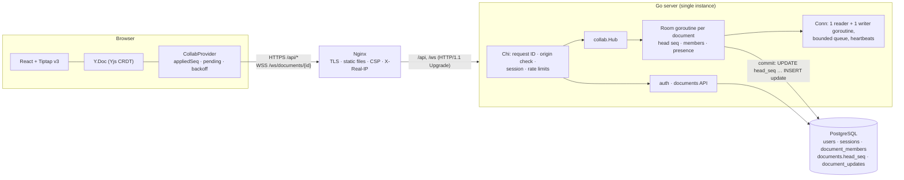

# CollabSpace

A real-time collaborative document editor: several people edit the same rich-text document at once, see who else is there, and lose nothing when a connection drops or the server restarts.

The project is about the **backend**. A Go server orders, persists and relays every edit through a custom WebSocket protocol, with server-side sessions, per-document permissions that take effect on live connections, rate limits, and a hardened Docker/Nginx deployment. The browser does the merging (Yjs CRDT); the server guarantees **order, durability and access control**.

> **Status:** it runs locally (bare binaries, or Docker Compose with Nginx and TLS from a private CA) and is tested by Go, Vitest and Playwright suites.
> - **Not deployed publicly:** there is no public URL. [`docs/deployment.md`](docs/deployment.md) is a VPS runbook that hasn't been executed.
> - **CI not yet run on GitHub:** the workflow is written, linted, and its jobs pass when run locally in Linux containers.

---

## What was hard (and how it's solved)

| Problem | Solution |
|---|---|
| Edits from many clients must reach everyone, in the same order, with nothing lost or duplicated, while people join mid-stream | One goroutine per open document ("room") owns its sequence head. Every update gets a gap-free per-document sequence number in a PostgreSQL transaction, and is acknowledged and broadcast **only after commit**. A client joining at head *H* gets *(after, H]* replayed from the database and everything after *H* live, so there's no gap or overlap. |
| Retries after a dropped connection must not apply an edit twice | Each update carries `(client_id, client_msg_id)`, with a unique key in the database. A resend gets the original sequence number back. |
| A commit whose outcome is unknown (connection lost during COMMIT) | The room never guesses: it resets, and clients replay from the database and resend with the same IDs, so deduplication settles it. |
| One slow browser must not stall a document | Bounded per-connection queues and non-blocking sends. A client that can't keep up is disconnected and catches up from the database. |
| Logging out, removing a member or changing a role must affect **open** connections | The hub closes the affected sockets immediately (4001/4003/4008), so queued edits from a removed member are dropped. Race windows around the handshake are closed and tested. |
| Unsaved edits when the session ends or the network drops | The client keeps them, asks the user to sign in again, and resends them with their original IDs. |

---

## Architecture



**What happens to one edit:**
1. **Browser:** Tiptap changes the Y.Doc. The provider batches the Yjs update for 50 ms, gives it a `client_msg_id`, keeps it in `pending`, and sends `{"type":"update"}`.
2. **Reader goroutine:** checks the role (viewers are refused), the size, and that the connection is still open, then queues the update to the document's room.
3. **Room:** in one PostgreSQL transaction it locks the document row, deduplicates, increments `head_seq` and inserts the update. **After COMMIT** it sends `committed{seq}` to the author and `update{seq}` to everyone else, each through that connection's bounded queue.
4. **Each writer goroutine** sends the frame. Receivers apply `seq == appliedSeq+1`, ignore duplicates, and resync on a gap.

The server never parses Yjs bytes. The Go side owns ordering and durability; the CRDT lives in the browser. The full design is in [`teach/phases/phase-0-architecture.md`](teach/phases/phase-0-architecture.md).

---

## Authentication, authorization and sessions
- **Passwords:** Argon2id (m = 19 MiB, t = 2, p = 1), constant-time comparison, a dummy hash for unknown emails (equal timing), and a bounded number of concurrent hashes.
- **Sessions:** opaque 32-byte random tokens; **only their SHA-256 is stored**; expiry is checked by the database clock. The cookie is `__Host-collabspace_session`: Secure, HttpOnly, SameSite=Lax.
- **Cross-site requests:** SameSite, plus an exact **Origin allowlist** on every state-changing request and on the WebSocket handshake, plus JSON-only bodies.
- **Per-document roles:** owner, editor, viewer. Non-members get **404**, so documents can't be discovered by guessing. Viewers can't write, and the server enforces it.
- **Revocation on live connections:**

  | Event | Close code | What happens |
  |---|---|---|
  | logout or session expiry | 4001 | the connection ends |
  | membership removed | 4003 | the connection ends |
  | role changed | 4008 | the client reconnects with the new role |

- **Rate limits:** per address, per account + address, per account overall, registration per address, and sharing per user. 429 with `Retry-After`. The client address comes from a proxy header only when that proxy is configured as trusted.

## Collaborative editing and persistence
- `document_updates(document_id, seq, user_id, client_id, client_msg_id, payload)` is append-only. `documents.head_seq` is advanced under a row lock in the same transaction, so sequence numbers have **no gaps**: a failed insert rolls back the increment too.
- Recovery is "give me everything after seq N". A refresh replays the log into a fresh Y.Doc; a reconnect replays only what was missed.

## WebSocket protocol (v1, JSON frames)
| Client → server | Server → client |
|---|---|
| `join {v, client_id, after_seq}` | `joined {head_seq, role}`, replayed `update`s, `synced {seq}` |
| `update {client_msg_id, data}` | `committed {client_msg_id, seq}` · `update {seq, data, user_id}` · `error {code, retryable}` · `presence {users}` |

- **Close codes that reconnect:** 1001 (shutdown), 4008 (resync: slow client, role change, room reset). The client uses full-jitter exponential backoff.
- **Close codes that stop:** 4001, 4003, 4004, 4009, 1009. On these the client stops and explains why.
- **Heartbeats:** ping every 25 s; a connection is dead after 60 s of silence.

## Presence
- **What it is:** the room's member list, grouped by user ID, so a user with three tabs is listed once. It is computed in the room goroutine after every event (no locks), and broadcast only when the set of users changes.
- **What it contains:** user ID, display name and role, taken from the server-side session and membership check, never from the client.
- **Reconnects:** a tab that reconnects replaces its own stale connection.

## Security and operational hardening
- **Images:**
  - Go server: 11 MB distroless, non-root, read-only filesystem, all Linux capabilities dropped;
  - Nginx: unprivileged, packages patched at build;
  - Trivy found 0 fixable HIGH/CRITICAL in both images when last scanned.
- **Network:** PostgreSQL is on an internal-only network with no published port.
- **Secrets:** supplied as files at runtime (`DATABASE_URL_FILE`), never in images or the environment.
- **Nginx:** TLS 1.2/1.3, HTTP→HTTPS, WebSocket upgrade with timeouts above the heartbeat, client-IP headers **overwritten** (so they can't be spoofed), a 64 KiB body limit, a strict **CSP without `'unsafe-inline'`**, and HSTS only when enabled.
- **Logs:** JSON logs with request IDs shared by Nginx and the app. A test runs a full session and proves no password, token, email or document text is logged.
- **Counters:** collaboration counters and **database pool statistics** are logged periodically.
- **Shutdown:** WebSockets close with 1001 and clients resync.
- **Review history:** an independent review in Week 5 (five areas, one reviewer each) found 22 defects. Where a defect could be tested, it was reproduced with a failing test before the fix, and the fix was checked by removing it and confirming the test fails. The few left untested are listed with the reason. See [`teach/phases/week-5-review.md`](teach/phases/week-5-review.md).

---

## Run it locally

**Requirements:** Go 1.26.10+ (the `go` directive downloads it automatically), Node 26, PostgreSQL 17.

```bash
createdb collabspace_dev && createdb collabspace_test
cp .env.example .env                                  # local values; never commit .env
set -a && . ./.env && set +a && go run ./cmd/server   # API + WebSocket on 127.0.0.1:8080, migrates on start
cd frontend && npm ci && npm run dev                  # http://localhost:5173 (proxies /api and /ws to :8080)
```

**Tests.** The integration tests need a database whose name contains `test`. Without the variable they **skip and still print `ok`**.

```bash
export COLLABSPACE_TEST_DATABASE_URL='postgres:///collabspace_test?host=/tmp'
gofmt -l . && go vet ./... && go test -race ./...
cd frontend && npm run build && npx vitest run && npx playwright test
```

## Docker deployment with TLS

```bash
cp deploy/env.example deploy/.env && deploy/gen-secrets.sh && deploy/gen-local-cert.sh   # local CA, localhost only
docker compose -f deploy/compose.yaml up -d --build --wait   # db → migrate → app → proxy, by health checks
deploy/smoke.sh                                               # 8 checks through Nginx/TLS
```

- **Local stack:** open `https://localhost:8443` (import `deploy/secrets/tls/ca.pem` to avoid the warning).
- **More:** day-two operations in [`docs/operations.md`](docs/operations.md); a public server in [`docs/deployment.md`](docs/deployment.md) (Let's Encrypt via a deploy hook, firewall, backups, rollback). The public procedure hasn't been run.

---

## Benchmarks (local, not production capacity)

**Method:** `cmd/loadtest` goes through **TLS → Nginx → app** like a browser. It registers users, opens one WebSocket per user, sends timestamped 100-byte updates, measures commit latency (send → `committed`) and end-to-end delivery latency (send → every other member), and counts delivered against expected. `deploy/loadtest.sh` samples container CPU and memory.

**Environment:** one Apple M4 laptop running the client, Nginx, the app and PostgreSQL together (Docker Desktop VM: 10 CPUs, 7.75 GiB). Runs of 10–30 s. Registration limits were lifted with a local-only override file.

| Connections | Commits/s | Commit p95 | Delivery p95 | Delivered / expected | Errors |
|---|---|---|---|---|---|
| 12 | 20 | 10.2 ms | 8.5 ms | 400 / 400 | 0 |
| 100 | 200 | 23.5 ms | 23.5 ms | 23,968 / 23,968 | 0 |
| 400 | 400 | 35.1 ms | 35.1 ms | 107,910 / 107,910 | 0 |
| 1,000 | 499 | 44.5 ms | 44.5 ms | 284,278 / 284,278 | 0 |

- **CPU at 1,000 connections, while editing:** app about 32% of one core, PostgreSQL about 25%.
- **Restart under load:** restarting the app with 500 connections open, all of them closed with 1001 within 10 ms of SIGTERM, and all resynced (p95 7.8 s, including 5 s of deliberate downtime).
- **Docker Desktop limitation:** its host port forwarding dropped part of a burst of 500 *simultaneous* reconnects (only 312/500 and 133/500 succeeded). Run inside the container network, the same burst succeeded 500/500 three times. Real clients spread reconnects with jittered backoff.

**These are laptop numbers for one instance, not a capacity claim.** Details: [`teach/phases/week-6-deployment.md`](teach/phases/week-6-deployment.md) §E.

---

## Limitations and next steps
- **One application instance.** Rooms and presence live in one process, so horizontal scaling would need per-document routing or a shared broadcast layer. Deploys cause a few seconds of reconnects.
- **Not deployed publicly;** public TLS and certificate renewal are unverified; **CI hasn't run on GitHub yet.**
- **Backups are manual** (`pg_dump`, with a restore-verification script); there's no point-in-time recovery.
- **Load testing** has been done only on one laptop, for short runs, up to 1,000 connections.
- **The upstream `postgres:17-alpine` image** carries known findings in `gosu`, which only runs at container start.
- **Not built yet:** no compaction or snapshots, so opening a document replays its whole log. No cursors, no version history, no account deletion, no password reset (no email delivery).

---

## Demo checklist

- [ ] The stack is up (`docker compose … ps` all healthy) and `deploy/smoke.sh` passes
- [ ] Two separate browser profiles (or one normal and one private window)
- [ ] Two accounts registered (Alice and Bob)

## Demo flow

About five minutes.
1. **Two users, one document:** Alice creates "Design notes" and shares it with Bob as **editor**. Both open it, type at the same time, and both see each other's text appear. The status pill says "Connected · Saved".
2. **Presence:** the toolbar shows "You" and the other person. Alice opens a second tab: she's still listed once. She closes it: nothing changes for Bob.
3. **Roles:** Alice changes Bob to **viewer**. Bob's editor turns read-only within a second ("View only"), and his presence entry shows "(viewing)". Alice removes Bob: his page shows "document not found".
4. **Reconnect:** restart the server (`docker compose -f deploy/compose.yaml restart app`) while Alice types. Her status goes "Offline · unsaved changes", then back to "Saved"; nothing is lost.
5. **Persistence:** reload both pages, and the document comes back from the server's update log. Sign out in another tab: the editor keeps any unsaved text and asks Alice to sign in again.

---

## Repository map
| Path | What |
|---|---|
| `cmd/server` | application server |
| `cmd/admin` | `migrate`, `migrate-status`, `claim-document` |
| `cmd/loadtest` | load-test harness |
| `cmd/healthcheck` | container readiness probe |
| `internal/collab` | hub, rooms, connections, presence, live revocation |
| `internal/store` | sequenced, idempotent append and bounded replay |
| `internal/auth`, `internal/documents` | sessions, passwords, membership and roles |
| `internal/ratelimit`, `internal/httpx`, `internal/config` | rate limits, middleware, configuration |
| `migrations/` | Goose SQL migrations (embedded) |
| `frontend/src/collab/provider.ts` | the client side of the protocol |
| `deploy/` | Compose, Dockerfiles, Nginx, and scripts for secrets, certificates, smoke tests, backups and load tests |
| `.github/workflows/ci.yml` | CI (Go race tests, frontend + Playwright, lint, image scan, Docker smoke) |
| `docs/` | operations and deployment runbooks |
| `teach/` | design notes and a week-by-week engineering log with test evidence |
